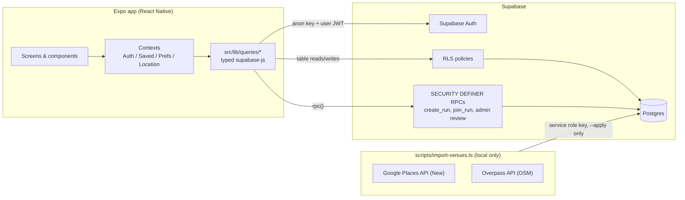

# Pick-Up

A React Native (Expo) app for finding nearby pickup sports games and venues on a map, backed by Supabase with Row Level Security enforced in Postgres.

---

## Features

- **Map-first discovery**: full-screen map with sport-filtered pins, clustering (`supercluster`), and a draggable bottom sheet (`@gorhom/bottom-sheet`).
- **Explore list**: filterable venues and runs, sorted by real haversine distance from the device location (via `expo-location`).
- **Venue and run detail**: schedule, skill level, seasonality warnings, and live attendance counts.
- **Accounts**: email/password auth through Supabase Auth, with sessions persisted in AsyncStorage. Includes an age-confirmation gate.
- **Saved items and attendance**: per-user saved venues and runs, plus "I'm Going" attendance, with optimistic UI updates.
- **User-created runs**: create, join, and cancel runs through Postgres RPCs that check the caller's permissions.
- **Trust signals**: each run shows a freshness or trust label based on its provenance fields (`confidence_score`, `last_verified_at`) and its recent user report count (`src/utils/trustSignal.ts`).
- **Accuracy reports**: users can flag runs that are inaccurate.
- **Admin candidate review**: an in-app screen where admins approve, reject, or flag staged run candidates before they go live.
- **Weather badges** for outdoor runs (OpenWeather) and address geocoding (Mapbox).

## Tech Stack

| Layer | Technology |
| --- | --- |
| Framework | Expo SDK 58, React Native 0.88, React 19 |
| Language | TypeScript |
| Navigation | React Navigation (native stack + bottom tabs) |
| Maps | `react-native-maps`, `supercluster` |
| UI / gestures | `@gorhom/bottom-sheet`, Reanimated, Gesture Handler |
| Backend | Supabase: Postgres, Auth, Row Level Security, RPC functions |
| Client storage | AsyncStorage (session persistence, guest fallback) |
| External APIs | OpenWeather (weather), Mapbox (geocoding) |
| Data import | Node + TypeScript script using Google Places API (New) and the OpenStreetMap Overpass API |

## Architecture



- Screens stay thin. Data comes in through hooks (`useVenues`, `useRuns`) and contexts, and all Supabase queries live in `src/lib/queries/`.
- `src/types/database.ts` types the Supabase client, and mapping functions convert database rows into app types.
- The import script runs on its own and is never bundled into the app. It reads its credentials only from `scripts/.env`.

## Data Pipeline: `scripts/import-venues.ts`

The script imports volleyball venues for Massachusetts and New Hampshire into `public.venues`.

1. **Grid search (Google Places).** The script covers the MA and NH bounding boxes with search points about 15 miles apart and makes one Text Search call per point. Places is a paid, metered API, so the script stops after 200 calls per run, logs every call, and warns if it stopped before covering the whole grid.
2. **Overpass (OpenStreetMap).** A single bounding-box query finds elements tagged `sport~volleyball`.
3. **Normalization.** Results from both sources are converted to the exact `public.venues` row shape. Rows missing a name, address, city, or state are marked `incomplete` and never inserted.
4. **Deduplication.** Two candidates within about 0.1 miles of each other with matching names are treated as the same place. The same check runs against existing `venues` rows. Matches are marked `duplicate_self` or `duplicate_existing` and excluded.
5. **Provenance.** Each imported row records `import_source` (`google_places` or `overpass_osm`) and `import_source_id` (a Google `place_id` or an OSM `type/id`). A partial unique index on that pair (migration `phase14_venue_import_source.sql`) blocks duplicate inserts of the same source record when the script runs again.
6. **Dry run vs. `--apply`.** By default the script writes nothing to the database. It writes every candidate, with its status and review notes, to `scripts/output/venues-preview.json` (gitignored). Only `--apply` inserts rows, and only rows with status `new`.

See [`scripts/README.md`](scripts/README.md) for the full details.

## Security Model

All tables have RLS enabled. Policies are defined in `supabase/schema.sql` and `supabase/migrations/`.

- **Public catalog**: anyone can read `venues` and `runs`. Neither table has an INSERT policy for `anon` or `authenticated`, so only the service role (the import script) or SECURITY DEFINER functions can write to them.
- **Per-user data**: `profiles`, `saved_venues`, `saved_runs`, `run_attendance`, and `run_reports` are scoped to `auth.uid()`. Users can only read and write their own rows.
- **User-created runs**: anyone can read `user_runs` and `run_participants`. Users can only insert or update rows they own. The `create_run` and `join_run` RPCs also require `profiles.age_confirmed = true`.
- **Aggregates without row exposure**: `get_run_attendance_count`, `get_run_participant_count`, and `get_run_recent_report_count` are SECURITY DEFINER functions that return counts only, so other users' rows stay hidden.
- **Staged data**: `run_candidates` has RLS enabled with no policies, so it is unreachable through the API except via the admin RPCs.
- **Admin authorization (`phase12_admin_authorization.sql`)**:
  - Admins are listed in a `public.admins` allowlist table. It has RLS enabled and no policies, so nobody can read or write it through the API.
  - `public.is_admin()` (SECURITY DEFINER) checks whether the caller is in that table.
  - `get_pending_run_candidates`, `approve_run_candidate`, `reject_run_candidate`, and `flag_run_candidate_for_clarification` each raise an error unless `is_admin()` returns true. EXECUTE on them is revoked from `PUBLIC` and granted only to `authenticated`.
  - This check replaced an earlier client-side email gate, so authorization is enforced in Postgres, not in the app.
- **Defense in depth**: an event trigger, `rls_auto_enable` (`phase13_rls_auto_enable.sql`), automatically enables RLS on any newly created table.

## Running Locally

Prerequisites: Node.js, npm, a Supabase project, and the Expo Go app on a phone.

```bash
git clone https://github.com/michaelnguyen-cs/pickup-app.git
cd pickup-app
npm install
```

**App environment.** Create `.env.local` in the repo root (it is gitignored) with:

```
EXPO_PUBLIC_SUPABASE_URL=
EXPO_PUBLIC_SUPABASE_ANON_KEY=
EXPO_PUBLIC_OPENWEATHER_API_KEY=   # optional: weather badges
EXPO_PUBLIC_MAPBOX_TOKEN=          # optional: geocoding
```

**Database.** In the Supabase SQL editor, run `supabase/schema.sql`, then the files in `supabase/migrations/` in phase order. `supabase/seed.sql` is optional sample data.

**Start the app:**

```bash
npx expo start
```

**Import script (optional).** Copy [`scripts/.env.example`](scripts/.env.example) to `scripts/.env` and fill it in. Then run:

```bash
npx tsx scripts/import-venues.ts          # dry run
npx tsx scripts/import-venues.ts --apply  # insert "new" venues
```

## Status

Prototype, device-tested via Expo Go; not released.

---

Built with Claude Code; architecture, data curation, and testing by Michael Nguyen.
